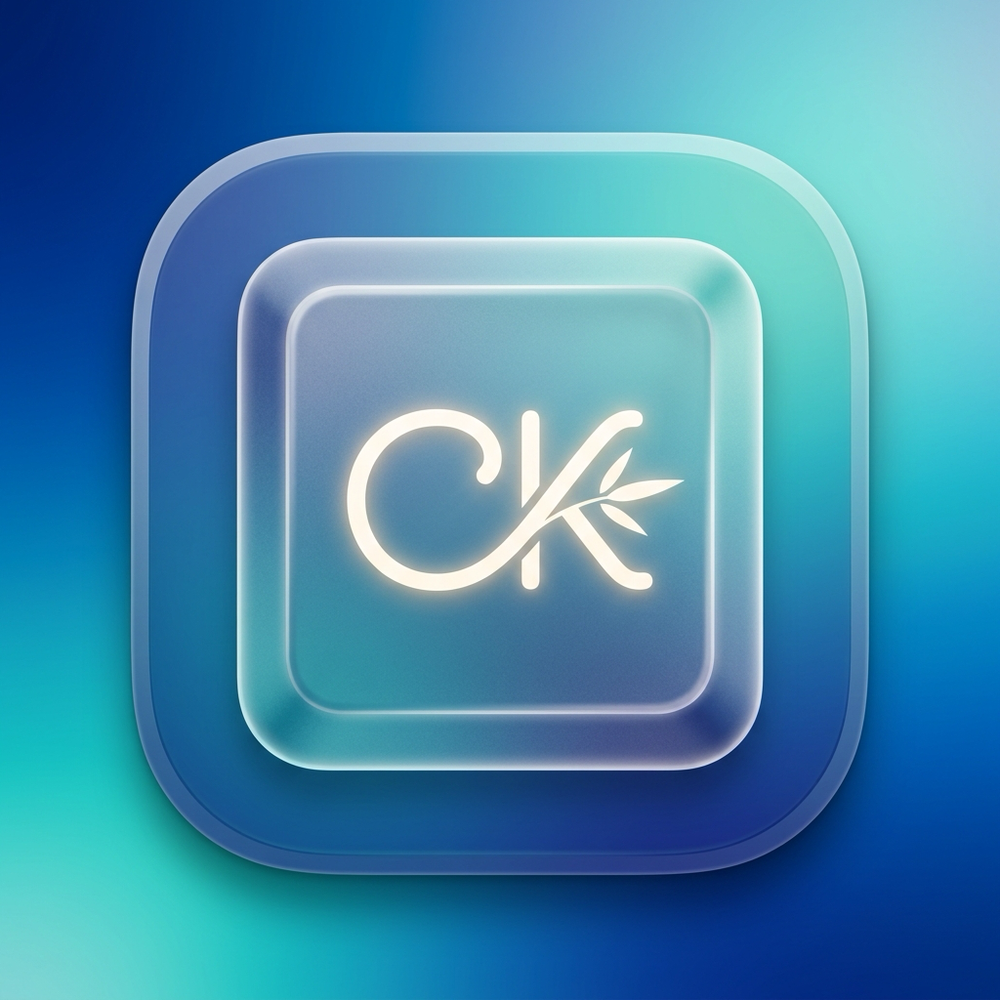

<p align="center">
  
</p>

<h1 align="center">ChillKey 🌿</h1>
<p align="center"><b>Bộ gõ tiếng Việt Native siêu nhẹ dành riêng cho macOS Apple Silicon (Chip M)</b></p>


ChillKey được sinh ra để giải quyết triệt để các vấn đề kinh niên của bộ gõ gốc macOS trên chip M:
- ❌ **Không bị nuốt chữ, mất ký tự** khi gõ nhanh.
- ❌ **Không bị nhảy phím, lặp từ** trên Chrome, VS Code, Slack, Notion, Spotlight.
- ❌ **Không có gạch chân inline phiền toái** (loại bỏ hoàn toàn xung đột composition của Text Services).
- ⚡ **Tối ưu 100% cho chip Apple Silicon (ARM64)**: Dung lượng app chỉ **~350 KB**, RAM < 15MB, tiêu tốn 0% CPU khi idle.

---

## 🚀 Tính năng nổi bật

- **Kiểu gõ**: Hỗ trợ đầy đủ **Telex**, **VNI**, **Simple Telex**.
- **Quy tắc đặt dấu thanh linh hoạt**:
  - Chuẩn mới (Modern): `hòa`, `hòe`, `thúy`
  - Chuẩn cũ (Traditional): `hoà`, `hoè`, `thuý`
- **Hoàn tác thông minh (Undo / Escape)**: Gõ lặp phím dấu để khôi phục ký tự gốc (`as` -> `á`, gõ thêm `s` -> `as`).
- **Phím tắt chuyển đổi nhanh**: Nhấn tổ hợp `Control + Shift` để chuyển đổi tức thì giữa Tiếng Việt (**🇻🇳 V**) và Tiếng Anh (**🇺🇸 E**).
- **Giao diện MenuBar & Settings hiện đại**: Thiết kế theo ngôn ngữ macOS Sequoia với SwiftUI.

---

## 📁 Cấu trúc dự án

```
ChillKey/
├── Sources/
│   ├── Engine/              # Bộ nhân xử lý tiếng Việt độc lập
│   │   ├── Models.swift     # Data models & kiểu gõ (Telex, VNI, ToneMark)
│   │   ├── Alphabet.swift   # Bảng tra cứu nguyên âm Unicode dựng sẵn
│   │   ├── ToneRules.swift  # Thuật toán đặt dấu thanh chuẩn mới / cũ
│   │   └── Engine.swift     # Finite State Machine & tính toán diff backspace
│   ├── Core/                # Tầng tương tác hệ thống macOS
│   │   ├── KeyCodes.swift   # Mã phím ảo macOS (Virtual key codes)
│   │   ├── KeySender.swift  # Giả lập phím Backspace & Unicode tốc độ cao
│   │   ├── Permission.swift # Kiểm tra & xin quyền Accessibility
│   │   └── EventTap.swift   # CGEventTap lắng nghe sự kiện toàn hệ thống
│   ├── App/                 # Giao diện người dùng & MenuBar
│   │   ├── AppState.swift   # Quản lý cấu hình & lưu UserDefaults
│   │   ├── SettingsView.swift # Cửa sổ Cài đặt viết bằng SwiftUI
│   │   ├── MenuBarController.swift # Quản lý status item & context menu
│   │   └── AppDelegate.swift # Vòng đời ứng dụng macOS
│   └── main.swift           # Điểm khởi chạy NSApplication
├── Tests/                   # Bộ Unit Test kiểm thử
│   ├── EngineTests.swift    # 42+ test cases Telex, VNI, hoán vị dấu
│   └── main.swift           # Test suite runner
├── Scripts/
│   ├── build.sh             # Script biên dịch và đóng gói ChillKey.app
│   └── run_tests.sh         # Script chạy tự động bộ test
├── Info.plist               # Cấu hình bundle macOS
└── vfs.json                 # VFS overlay tối ưu toolchain CommandLineTools
```

---

## 🛠️ Hướng dẫn Biên dịch & Chạy ứng dụng

### 1. Chạy Unit Test kiểm tra Engine:
```bash
./Scripts/run_tests.sh
```

### 2. Biên dịch và đóng gói ứng dụng:
```bash
./Scripts/build.sh
```
Sau khi build xong, file ứng dụng nằm tại:
```
build/ChillKey.app
```

### 3. Khởi chạy ChillKey:
```bash
open build/ChillKey.app
```
*(Hoặc kéo `ChillKey.app` vào thư mục `/Applications` để dùng hàng ngày)*.

---

## 🔐 Cấp quyền Accessibility (Chỉ cần 1 lần duy nhất)

Do ChillKey bắt sự kiện bàn phím qua `CGEventTap` để khắc phục lỗi gõ của hệ thống:
1. Khi mở app lần đầu, nếu chưa cấp quyền, cửa sổ Cài đặt của ChillKey sẽ hiện nút **"Cấp quyền"**.
2. Nhấn vào nút đó để mở: **System Settings > Privacy & Security > Accessibility** (Quyền riêng tư & Bảo mật > Trợ năng).
3. Bật công tắc cho phép **ChillKey**.
4. Biểu tượng **🇻🇳 V** sẽ xuất hiện trên thanh MenuBar ở góc trên bên phải màn hình.

---

## ⌨️ Bảng phím tắt & Thao tác nhanh

| Thao tác | Phím tắt / Hành vi |
| :--- | :--- |
| **Bật / Tắt Tiếng Việt** | Nhấn đồng thời `Control + Shift` |
| **Mở Cài đặt** | Bấm vào icon **V / E** trên MenuBar -> chọn **Cài đặt...** (hoặc `Cmd + ,`) |
| **Đổi nhanh kiểu gõ** | Bấm vào icon trên MenuBar -> chọn **Kiểu gõ** -> Telex / VNI |
| **Thoát app** | Bấm vào icon trên MenuBar -> chọn **Thoát ChillKey** |
